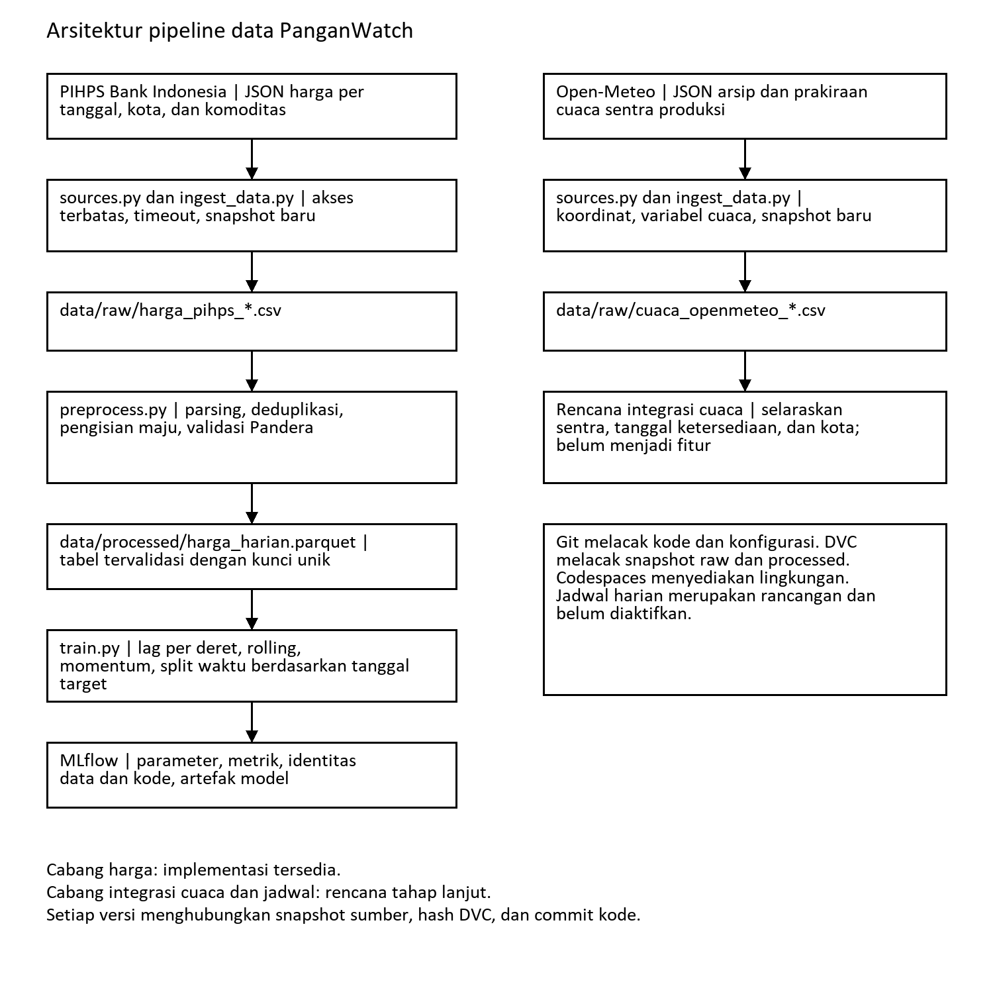
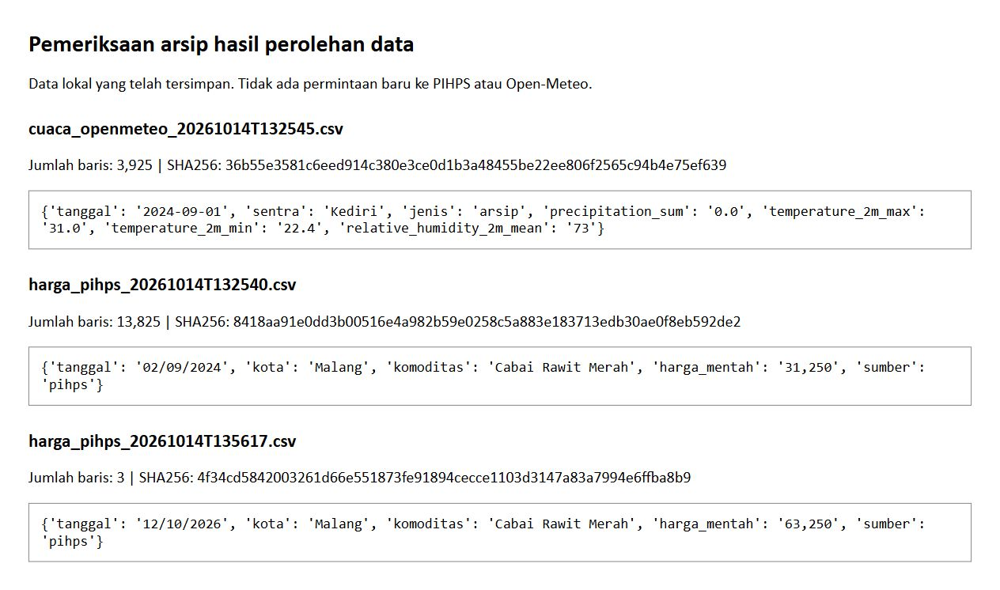

# LK-03 Perancangan Arsitektur Pipeline Data

PanganWatch: Peringatan Dini Lonjakan Harga Pangan Berbasis Continual Learning

Nama: Ghufron Bagaskara

NIM: 235150200111012

Mata kuliah: Machine Learning Operations (CIF60050)

## 1. Pendahuluan

PanganWatch merupakan proyek peramalan harga pangan yang dikembangkan secara bertahap melalui rangkaian lembar kerja. LK-01 menetapkan masalah, sumber data, serta kebutuhan pembaruan model. LK-02 menyediakan repositori dan lingkungan pengembangan melalui GitHub Codespaces. Berdasarkan kedua kegiatan tersebut, LK-03 merumuskan alur perolehan, pengolahan, dan penyimpanan data yang menjadi dasar implementasi LK-04.

Peneliti merancang pipeline untuk lima komoditas pada lima kota, yaitu Malang, Surabaya, Jakarta Pusat, Bandung, dan Medan. Komoditas yang digunakan meliputi cabai rawit merah, cabai merah keriting, bawang merah, telur ayam ras, dan beras medium. Satu observasi harga mewakili satu kombinasi tanggal, kota, dan komoditas. Dengan demikian, pengolahan harus mempertahankan identitas masing-masing deret agar harga antarwilayah dan antarkomoditas tidak tercampur.

## 2. Identifikasi Sumber Data Dinamis

### 2.1 Harga Pangan

Harga diperoleh dari Pusat Informasi Harga Pangan Strategis Bank Indonesia melalui endpoint JSON `GetGridDataDaerah` yang digunakan oleh tabel harga pasar tradisional. Parameter permintaan mencakup jenis pasar, kode provinsi, kode kabupaten atau kota, kode komoditas, serta rentang tanggal. Kode referensi dan wilayah ditetapkan pada `config/sources.yaml`, sedangkan komunikasi dengan sumber dilakukan oleh `KlienPIHPS` pada `src/sources.py`.

Respons sumber memiliki bentuk pivot, yaitu tanggal ditempatkan sebagai nama kolom. Skrip mengambil baris komoditas pada level 2 dan mengubahnya menjadi tabel panjang. Nilai harga dipertahankan sebagai teks pada data mentah karena sumber dapat menggunakan tanda koma atau titik sebagai pemisah ribuan. Pembersihan angka dilakukan secara terpisah agar hasil sumber tetap dapat diperiksa kembali.

Sumber tersebut bersifat dinamis karena observasi baru dan revisi harga dapat muncul pada tanggal berikutnya. Pengambilan berkala menggunakan jendela tanggal yang saling tumpang tindih, sehingga perubahan terhadap tanggal sebelumnya tetap tercatat. Endpoint merupakan bagian dari situs sumber dan tidak memiliki kontrak API yang digunakan secara formal dalam proyek. Perubahan parameter atau struktur respons menjadi risiko yang perlu diperiksa sebelum hasil dipromosikan menjadi data olahan.

### 2.2 Cuaca Sentra Produksi

Data cuaca diperoleh dari Open-Meteo melalui layanan arsip dan prakiraan. Variabel yang diambil meliputi curah hujan, suhu maksimum, suhu minimum, dan kelembapan relatif rata-rata. Konfigurasi menggunakan koordinat Kediri, Blitar, Garut, Brebes, dan Nganjuk. Data cuaca merupakan kandidat variabel eksogen, sedangkan harga tetap menjadi variabel target.

Pemetaan sentra ke kota pada konfigurasi merupakan asumsi operasional awal. Pemetaan tersebut belum membuktikan hubungan kausal antara perubahan cuaca dan harga. Penggabungan cuaca dengan harga perlu mempertimbangkan tanggal ketersediaan arsip, jenis observasi, serta jeda pengaruh cuaca. Pada implementasi hingga LK-06, data cuaca disimpan sebagai data mentah, tetapi belum digunakan sebagai fitur model. Pemisahan ini mempertahankan data untuk pengembangan berikutnya tanpa menyatakan bahwa fitur cuaca telah selesai diterapkan.

Tabel 2.1 menyajikan peran masing-masing sumber.

| Sumber | Mekanisme akses | Peran | Penyimpanan awal |
| --- | --- | --- | --- |
| PIHPS Bank Indonesia | Requests, respons JSON tabel harga | Target dan dasar fitur historis harga | `data/raw/harga_pihps_<stempel>.csv` |
| Open-Meteo | Requests, respons JSON arsip dan prakiraan | Kandidat fitur cuaca sentra produksi | `data/raw/cuaca_openmeteo_<stempel>.csv` |

## 3. Rancangan Pipeline ETL

### 3.1 Extract

Tahap extract dijalankan melalui `src/ingest_data.py`. Mode backfill digunakan untuk menyediakan arsip awal, sedangkan mode harian digunakan untuk pembaruan jendela pendek. Setiap hasil pengambilan disimpan sebagai berkas CSV baru dengan stempel waktu hingga detik. Berkas sebelumnya dipertahankan sehingga revisi sumber tidak menghapus bukti pengambilan terdahulu.

Permintaan dapat dibatasi berdasarkan sumber, kota, dan komoditas. Pembatasan ini memungkinkan pengujian dengan cakupan kecil. Gangguan koneksi ditangani dengan timeout dan percobaan ulang terbatas. Jika satu pasangan harga gagal, kegagalan dicatat dan pasangan berikutnya tetap dapat diproses. Oleh karena itu, keberhasilan sebagian batch tidak boleh langsung dianggap sebagai kelengkapan seluruh wilayah.

### 3.2 Transform

Prapemrosesan membaca berkas harga mentah kemudian memperoleh waktu pengambilan dari nama berkas. Tanggal dikonversi ke tipe waktu, pemisah ribuan dibersihkan, dan entri tanpa tanggal atau harga yang sah dibuang. Harga di luar rentang Rp5.000 sampai Rp300.000 dikeluarkan sebagai aturan pemeriksaan awal. Ambang tersebut merupakan keputusan konfigurasi proyek yang perlu dievaluasi apabila cakupan komoditas berubah.

Kunci data terdiri atas tanggal, kota, dan komoditas. Jika kunci yang sama muncul pada beberapa berkas, nilai dari pengambilan terbaru dipilih. Selanjutnya, setiap deret disusun kembali pada kalender Senin sampai Jumat dan nilai kosong diisi dengan harga terakhir yang tersedia. Baris hasil pengisian diberi nilai `True` pada kolom `is_imputed`. Kalender tersebut tidak mengecualikan hari libur nasional, sehingga pengisian bukan bukti adanya survei pada setiap tanggal.

Pandera memeriksa tipe data, nilai wajib, rentang harga, dan keunikan kunci sebelum penyimpanan. Rekayasa fitur dilakukan pada tahap pemodelan melalui `src/train.py`, yaitu fitur harga relatif berjeda, statistik jendela 7 dan 30 observasi, momentum, volatilitas, hari dalam minggu, serta bulan. Jeda dihitung per pasangan kota dan komoditas. Satuan jeda adalah observasi pada kalender kerja, sehingga tujuh observasi tidak selalu sama dengan tujuh hari kalender.

### 3.3 Load dan Integrasi Infrastruktur

Hasil prapemrosesan ditulis ke `data/processed/harga_harian.parquet`. Format Parquet digunakan untuk menyimpan tabel bertipe data yang menjadi masukan pemodelan. Kode dan konfigurasi berada pada repositori `MLOps-PanganWatch`, sedangkan data mentah dan olahan dikelola melalui DVC pada LK-05. Lingkungan Codespaces menggunakan definisi `.devcontainer/devcontainer.json` yang telah disediakan pada LK-02.

Rancangan tidak mensyaratkan seluruh proses dijalankan melalui satu skrip besar. Pemisahan ingesti, prapemrosesan, dan pelatihan memungkinkan kesalahan sumber diperiksa sebelum model dilatih. Pengulangan prapemrosesan terhadap snapshot mentah yang sama menggunakan aturan pemilihan kunci yang sama, sehingga tidak menggandakan observasi pada tabel olahan.

### 3.4 Diagram Arsitektur

Diagram berikut menunjukkan alur yang telah menjadi struktur implementasi proyek. Cabang cuaca belum terhubung ke tabel fitur model.

## 4. Mekanisme Pembaruan dan Rencana Versioning

Rencana pada LK-01 menetapkan pembaruan harian pada pukul 15.00 WIB melalui GitHub Actions. Pada rancangan ini, urutan pekerjaan adalah mengambil data, memeriksa hasil, menjalankan prapemrosesan, kemudian menyimpan versi dataset yang lolos validasi. Pelatihan menggunakan versi tersebut sebagai masukan. Jadwal otomatis merupakan bagian rancangan; tersedianya skrip yang dapat dijalankan ulang belum membuktikan bahwa workflow terjadwal telah aktif.

Versi pertama berisi arsip awal. Versi berikutnya berisi snapshot tambahan atau revisi harga tanpa menghapus berkas sebelumnya. DVC menghitung hash isi dataset dan menyimpan penunjuknya pada Git. Nama snapshot mencatat waktu pengambilan, sedangkan hash mencatat perubahan isi. Dengan demikian, waktu penarikan, versi data, dan versi kode mempunyai peran yang berbeda dan perlu disimpan bersama saat pelatihan.

Snapshot tambahan tidak selalu menambah observasi unik. Apabila semua kunci sudah tersedia, snapshot hanya dapat menghasilkan revisi atau pengulangan harga. Pemeriksaan perubahan perlu memisahkan jumlah berkas mentah, jumlah baris mentah, dan jumlah kunci unik pada tabel olahan. Prinsip tersebut menjadi dasar audit versi data pada LK-05.

## 5. Skema Data Awal

Tabel 5.1 menyajikan skema harga mentah yang benar-benar digunakan oleh skrip ingesti.

| Kolom | Bentuk awal | Keterangan |
| --- | --- | --- |
| `tanggal` | Teks DD/MM/YYYY | Tanggal observasi sumber |
| `kota` | Teks | Identitas wilayah konsumsi |
| `komoditas` | Teks | Identitas komoditas |
| `harga_mentah` | Teks | Harga dengan format angka dari sumber |
| `sumber` | Teks | Nilai `pihps` |

Tabel 5.2 menyajikan skema cuaca mentah.

| Kolom | Bentuk awal | Keterangan |
| --- | --- | --- |
| `tanggal` | Teks YYYY-MM-DD | Tanggal cuaca |
| `sentra` | Teks | Nama titik koordinat produksi |
| `jenis` | Teks | `arsip` atau `prakiraan` |
| `precipitation_sum` | Numerik | Curah hujan harian |
| `temperature_2m_max` | Numerik | Suhu maksimum harian |
| `temperature_2m_min` | Numerik | Suhu minimum harian |
| `relative_humidity_2m_mean` | Numerik | Kelembapan relatif rata-rata |

Tabel 5.3 menyajikan kontrak tabel harga olahan.

| Kolom | Tipe hasil | Aturan |
| --- | --- | --- |
| `tanggal` | Datetime | Wajib terisi |
| `kota` dan `komoditas` | String | Wajib terisi |
| `harga` | Float | Rp5.000 sampai Rp300.000 |
| `is_imputed` | Boolean | Penanda pengisian nilai kosong |
| `ditarik_pada` | Datetime | Waktu snapshot yang dipilih |

Kombinasi `tanggal`, `kota`, dan `komoditas` wajib unik. Kolom di luar kontrak tersebut tidak diperbolehkan oleh validasi ketat yang digunakan pada prapemrosesan.

## 6. Bukti Data yang Telah Diperoleh

Pemeriksaan lokal menemukan `harga_pihps_20261014T132540.csv` sebanyak 13.825 baris dan `cuaca_openmeteo_20261014T132545.csv` sebanyak 3.925 baris. Selain itu, terdapat snapshot harga `harga_pihps_20261014T135617.csv` sebanyak tiga baris. Angka tersebut dihitung dari CSV yang tersimpan, bukan dari pengambilan ulang terhadap layanan sumber.

Contoh rekaman pertama harga adalah tanggal 02/09/2024, kota Malang, komoditas Cabai Rawit Merah, dan harga mentah `31,250`. Contoh rekaman cuaca adalah tanggal 2024-09-01, sentra Kediri, jenis arsip, dan curah hujan 0,0. Rekaman ini memperlihatkan bahwa kedua bentuk respons telah disimpan menjadi tabel mentah. Bukti tersebut membuktikan keberadaan hasil perolehan sebelumnya; keterjangkauan layanan pada saat laporan dibaca tidak disimpulkan dari arsip lokal.

Gambar 6.1. Pemeriksaan berkas hasil perolehan data dan contoh rekamannya secara lokal.

## 7. Kesimpulan

Rancangan pipeline mempertahankan snapshot mentah, menyelesaikan revisi berdasarkan waktu pengambilan, dan memvalidasi tabel harga sebelum pemodelan. Struktur tersebut menghubungkan luaran LK-02 dengan implementasi LK-04 serta persiapan versioning pada LK-05. Penggunaan cuaca sebagai fitur, pengaturan jadwal produksi, dan pemeriksaan ketersediaan data secara point-in-time masih memerlukan pengembangan lanjutan sebelum sistem dinyatakan sebagai layanan produksi.
