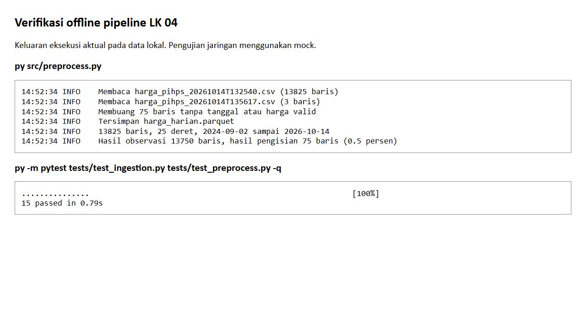

# LK-04 Implementasi Penarikan Data Dinamis dan Prapemrosesan

PanganWatch: Peringatan Dini Lonjakan Harga Pangan Berbasis Continual Learning

Nama: Ghufron Bagaskara

NIM: 235150200111012

Mata kuliah: Machine Learning Operations (CIF60050)

## 1. Tujuan dan Kedudukan Implementasi

LK-04 menerapkan rancangan pipeline pada LK-03 melalui skrip ingesti dan prapemrosesan. Peneliti memisahkan komunikasi dengan sumber, penyimpanan snapshot, dan pembersihan data agar masing-masing proses dapat diperiksa secara mandiri. Luaran utama berupa kode Python pada `src/`, sampel CSV pada `data/raw/`, dan petunjuk eksekusi pada README. Laporan ini menjadi penjelasan pendamping terhadap artefak tersebut.

## 2. Komponen Implementasi

| Berkas | Tanggung jawab |
| --- | --- |
| `src/sources.py` | Membaca konfigurasi dan meminta JSON PIHPS serta Open-Meteo |
| `src/ingest_data.py` | Menentukan cakupan pengambilan dan menyimpan snapshot CSV |
| `src/preprocess.py` | Membersihkan harga, memilih revisi terbaru, mengisi nilai kosong, dan memvalidasi skema |
| `config/sources.yaml` | Menetapkan endpoint, kode wilayah, komoditas, koordinat, dan batas permintaan |
| `tests/test_preprocess.py` | Memeriksa parsing harga, revisi, kalender kerja, dan penamaan snapshot |
| `README.md` | Menjelaskan lingkungan dan urutan penggunaan proyek |

Lingkungan pengembangan mengikuti `.devcontainer/devcontainer.json` dari LK-02. Pada Codespaces, terminal berjalan di dalam kontainer Python. Pada Windows, perintah Python yang sama dapat dijalankan melalui PowerShell setelah lingkungan proyek diaktifkan. Dependensi tetap mengikuti `requirements.txt` agar penggunaan pustaka dapat ditelusuri bersama versi kode.

## 3. Penarikan Data dan Simulasi Periodik

### 3.1 Mekanisme Penarikan

`ingest_data.py` menyediakan mode backfill dan mode pembaruan harian. Mode backfill memakai tanggal awal pada konfigurasi, sedangkan pembaruan harga memakai jendela tiga hari ke belakang hingga hari pelaksanaan. Arsip cuaca memakai H-8 sampai H-5 karena jeda ketersediaan arsip lima hari. Prakiraan disimpan terpisah melalui nilai jenis. Pembatasan `--hanya`, `--kota`, dan `--komoditas` menyediakan cakupan kecil untuk pemeriksaan. Pembatasan kota dan komoditas berlaku pada harga PIHPS.

Klien harga mengambil kombinasi kota dan komoditas melalui Requests. Respons diubah dari bentuk pivot menjadi satu baris per tanggal, kota, dan komoditas. Nilai harga belum dikonversi ke bilangan pada tahap ini. Setiap eksekusi menyimpan nama berkas dengan pola `harga_pihps_YYYYMMDDTHHMMSS.csv`. Berkas dibuka dalam mode eksklusif. Jika dua eksekusi memperoleh stempel waktu yang sama, eksekusi kedua ditolak melalui FileExistsError dan berkas pertama tetap dipertahankan. Cara tersebut mencegah penimpaan arsip lama.

Gangguan koneksi ditangani melalui timeout dan percobaan ulang terbatas. Galat sementara pada satu pasangan harga dicatat agar pasangan lain tetap dapat diperoleh. Respons HTTP 403, HTTP 429, serta halaman CAPTCHA menghentikan seluruh eksekusi tanpa percobaan ulang. Anggaran 30 permintaan berlaku bersama untuk semua sumber dan menghitung setiap percobaan ulang. Pembatasan cakupan dan jeda antarpermintaan mengurangi beban layanan, tetapi tidak menjamin layanan selalu menerima akses otomatis. Jika akses ditolak, proses harus dihentikan dan arsip yang telah tersedia digunakan untuk kegiatan pengembangan.

### 3.2 Petunjuk Eksekusi

Urutan berikut dijalankan dari direktori akar `MLOps-PanganWatch`.

```powershell
python src/ingest_data.py --help
python src/preprocess.py
python -m pytest tests -q
```

Perintah pertama hanya menampilkan pilihan dan tidak mengirim permintaan. Prapemrosesan dan pengujian dapat dikerjakan secara lokal menggunakan data tersimpan. Untuk demonstrasi pengambilan terbatas pada saat sumber mengizinkan akses, perintahnya sebagai berikut.

```powershell
python src/ingest_data.py --hanya harga --kota Malang --komoditas "Cabai Rawit Merah"
```

Tarikan harga penuh memerlukan 25 permintaan dan cuaca memerlukan 10 permintaan sebelum retry. Keduanya dijalankan terpisah dengan --hanya harga atau --hanya cuaca agar setiap eksekusi berada di bawah anggaran 30. Mode backfill dan pembaruan cuaca tersedia dalam skrip, tetapi tidak perlu dijalankan ulang untuk memeriksa hasil LK ini. Arsip awal telah tersedia. Pengambilan baru hanya dilakukan apabila diperlukan dan setelah memeriksa rentang tanggal serta batas permintaan pada konfigurasi.

### 3.3 Hasil Snapshot yang Tersedia

| Berkas | Jumlah baris | Peran |
| --- | ---: | --- |
| `harga_pihps_20261014T132540.csv` | 13.825 | Arsip harga awal |
| `cuaca_openmeteo_20261014T132545.csv` | 3.925 | Arsip dan prakiraan cuaca |
| `harga_pihps_20261014T135617.csv` | 3 | Pengambilan harga terbatas berikutnya |

Perhitungan baris dilakukan terhadap berkas CSV lokal. Snapshot tambahan berisi Malang dan Cabai Rawit Merah pada tiga tanggal. Keberadaan snapshot kedua menunjukkan bentuk penyimpanan periodik, tetapi jumlah tiga baris tidak otomatis berarti tiga observasi baru pada dataset olahan. Prapemrosesan tetap menentukan apakah kunci tersebut merupakan tambahan, pengulangan, atau revisi.

## 4. Tahapan Prapemrosesan

### 4.1 Parsing dan Pemeriksaan Nilai

Skrip membaca semua snapshot harga kemudian menambahkan kolom `ditarik_pada` dari stempel nama berkas. Tanggal observasi dikonversi dari DD/MM/YYYY. Tanda hubung, teks kosong, dan nilai yang tidak dapat diurai dianggap tidak valid. Pemisah ribuan koma dan titik dibersihkan agar `23,700` dan `23.700` sama-sama menjadi 23.700 rupiah. Baris tanpa tanggal atau harga yang sah dikeluarkan sebelum transformasi berikutnya.

Pemeriksaan rentang membatasi harga pada Rp5.000 sampai Rp300.000. Rentang ini digunakan sebagai gerbang awal untuk lingkup komoditas proyek, bukan sebagai batas yang berlaku untuk semua komoditas pangan. Apabila lingkup diperluas, aturan perlu dikaji kembali agar kenaikan harga yang sah tidak keliru dihapus.

### 4.2 Deduplikasi dan Revisi

Identitas observasi ditentukan oleh tanggal, kota, dan komoditas. Berkas ingesti tidak disunting apabila sumber merevisi harga. Skrip mengurutkan rekaman berdasarkan waktu pengambilan dan memilih rekaman terbaru untuk setiap kunci. Dengan demikian, arsip mentah mempertahankan riwayat, sedangkan tabel olahan hanya memuat satu nilai terpilih pada setiap kunci.

### 4.3 Pengisian Nilai Kosong

Setiap deret disusun pada tanggal Senin sampai Jumat antara observasi pertama dan terakhir. Nilai yang kosong diisi maju menggunakan harga sebelumnya. Kolom `is_imputed` menandai baris tersebut sehingga hasil pengisian dapat dibedakan dari observasi sumber. Akhir pekan tidak ditambahkan. Hari libur nasional belum dikeluarkan secara khusus dari kalender, sehingga baris pada hari tersebut dapat menjadi hasil pengisian.

Pengisian maju tidak mengambil harga masa depan. Namun, penggunaan revisi harga terbaru pada keseluruhan arsip tetap membutuhkan perhatian saat evaluasi historis. Stempel pengambilan disimpan agar pengembangan berikutnya dapat membedakan informasi yang benar-benar tersedia pada saat prediksi dari revisi yang muncul kemudian.

### 4.4 Validasi dan Penyimpanan

Pandera memeriksa kolom tanggal, kota, komoditas, harga, penanda pengisian, dan waktu pengambilan. Semua kolom wajib terisi, harga harus berada pada rentang yang ditetapkan, dan kunci observasi wajib unik. Validasi menggunakan skema ketat sehingga kolom yang tidak dikenal juga ditolak. Data yang lolos ditulis ke `data/processed/harga_harian.parquet` sebagai masukan tahap pemodelan.

Prapemrosesan saat ini khusus mengolah harga. Cuaca tetap berada pada zona mentah dan belum digabungkan ke Parquet harga. Oleh karena itu, keberadaan arsip cuaca tidak dinyatakan sebagai penyelesaian rekayasa fitur cuaca.

## 5. Verifikasi dan Batasan

Pengujian prapemrosesan memeriksa pemisah ribuan, sel kosong, harga di luar rentang, pemilihan revisi terbaru, pengisian hari kerja, pengecualian akhir pekan, dan penolakan nama berkas tanpa stempel waktu. Pengujian tersebut melindungi aturan yang berpengaruh langsung terhadap identitas dan nilai observasi. Eksekusi `python -m pytest tests/test_preprocess.py -q` menghasilkan tujuh pengujian lulus. Setelah pengujian ingesti disertakan, eksekusi tests/test_ingestion.py dan tests/test_preprocess.py menghasilkan 15 pengujian lulus. Delapan pemeriksaan tambahan mencakup penghentian akses, perhitungan anggaran termasuk retry, propagasi penghentian antarbatch, rentang arsip, dan penolakan penimpaan berkas. Pemeriksaan Parquet menghasilkan 13.825 baris pada 25 deret untuk rentang 2 September 2024 sampai 14 Oktober 2026. Sebanyak 75 baris merupakan hasil pengisian, yaitu sekitar 0,54 persen dari seluruh baris. Prapemrosesan juga dijalankan ulang terhadap snapshot lokal. Isi tabel hasilnya identik dengan tabel terversi, meskipun serialisasi Parquet dapat menghasilkan byte berbeda antarversi pustaka. Snapshot byte yang dipakai pada DVC dipertahankan untuk menjaga identitas eksperimen. Nilai tersebut merupakan hasil pemeriksaan data aktual, sedangkan pemeriksaan jaringan baru tidak dilakukan untuk menyusun laporan ini. Hasil eksekusi pengujian serta ringkasan keluaran pipeline disertakan pada lampiran verifikasi.



Gambar 5.1. Hasil eksekusi prapemrosesan dan pengujian terhadap data tersimpan.

Batasan implementasi meliputi ketergantungan pada struktur endpoint PIHPS, penggunaan kalender kerja tanpa daftar libur nasional, dan integrasi cuaca yang belum masuk ke tabel fitur. Menjalankan skrip secara berulang telah tersedia, sedangkan operasi terjadwal pada layanan produksi memerlukan workflow serta pengawasan kelengkapan batch. Bukti dari data tersimpan tidak digunakan untuk menyatakan bahwa layanan sumber dapat diakses setiap saat.

## 6. Keterkaitan dengan LK-05 dan LK-06

Snapshot mentah serta Parquet olahan menjadi objek pelacakan DVC pada LK-05. Pemisahan arsip dan hasil transformasi memungkinkan perubahan sumber diperiksa tanpa kehilangan masukan awal. Pada LK-06, tabel harga tersebut digunakan untuk menyusun fitur dan menjalankan eksperimen yang dicatat melalui MLflow. Dengan demikian, artefak LK-04 berfungsi sebagai jembatan antara rancangan data dan eksperimen model, bukan sebagai laporan yang berdiri sendiri tanpa kode.

## 7. Daftar Artefak Pengumpulan

Artefak utama pengumpulan meliputi `src/ingest_data.py`, `src/preprocess.py`, `src/sources.py`, `config/sources.yaml`, sampel data mentah pada `data/raw/`, dan README berisi petunjuk eksekusi. Berkas `requirements.txt` serta pengujian disertakan untuk mendukung reproduksi lingkungan. Laporan PDF dan DOCX merupakan pendamping; keduanya tidak menggantikan kode dan sampel data yang dipersyaratkan RPS.
