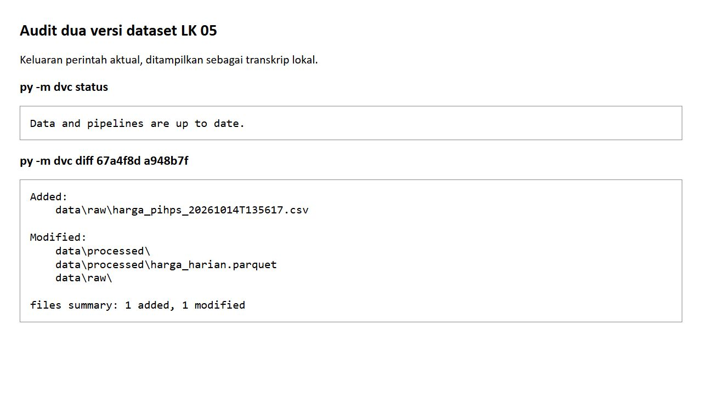

# LK-05 Manajemen Versi Dataset Menggunakan DVC

PanganWatch: Peringatan Dini Lonjakan Harga Pangan Berbasis Continual Learning

Nama: Ghufron Bagaskara

NIM: 235150200111012

Mata kuliah: Machine Learning Operations (CIF60050)

## 1. Tujuan dan Keterkaitan dengan LK-04

LK-05 melacak perubahan dataset yang dihasilkan oleh ingesti dan prapemrosesan pada LK-04. Peneliti menggunakan DVC untuk menyimpan identitas isi data, sedangkan Git menyimpan kode dan berkas penunjuk. Pemisahan tersebut memungkinkan versi dataset diperiksa bersama versi kode tanpa memasukkan seluruh CSV dan Parquet ke riwayat Git.

Pelacakan dilakukan terhadap direktori data/raw dan data/processed. Direktori mentah mencakup harga serta cuaca, sedangkan direktori olahan memuat harga_harian.parquet. Penggunaan direktori sebagai objek pelacakan membuat penambahan snapshot baru tercatat pada hash direktori. Versi awal dan versi berikutnya sudah terdapat pada riwayat lokal, sehingga pemeriksaan ini tidak memerlukan penarikan ulang dari layanan sumber.

## 2. Inisialisasi dan Artefak Versioning

Inisialisasi DVC serta pelacakan awal tercatat pada commit 67a4f8d. Commit a948b7f menyimpan snapshot harga tambahan dan perubahan penunjuk data. Berkas data/raw.dvc dan data/processed.dvc mencatat hash, jumlah byte, jumlah berkas, serta lokasi keluaran. Isi data tidak dilacak sebagai berkas biasa oleh Git; aturan tersebut ditetapkan melalui data/.gitignore. Konfigurasi inti DVC berada pada .dvc/config, sedangkan berkas .dvcignore mengatur pengecualian pemeriksaan DVC.

Remote bernama lokal menggunakan penyimpanan pada komputer yang sama. Remote tersebut dipakai sebagai pilihan penyimpanan untuk kegiatan perkuliahan dan bukan layanan object storage bersama. Konfigurasi lokal belum menjamin data dapat diperoleh pada Codespaces komputer lain. Oleh karena itu, paket pengumpulan menyertakan snapshot data dan cache yang diperlukan serta riwayat Git dalam bentuk bundle. Penggunaan AWS S3, GCP, atau MinIO tidak dinyatakan telah diterapkan.

## 3. Perbandingan Dua Versi Data

Tabel 3.1 menyajikan transisi versi mentah berdasarkan metadata DVC yang benar-benar tersimpan.

| Komponen | Versi 1 pada 67a4f8d | Versi 2 pada a948b7f |
| --- | --- | --- |
| Jumlah berkas raw | 2 | 3 |
| Ukuran raw | 881.964 byte | 882.164 byte |
| Baris CSV harga gabungan | 13.825 | 13.828 |
| Baris CSV cuaca | 3.925 | 3.925 |
| Observasi unik harga olahan | 13.825 | 13.825 |
| Kunci baru harga olahan | Tidak berlaku | 0 |
| Perubahan nilai harga olahan | Tidak berlaku | 0 |
| Perubahan waktu pengambilan terpilih | Tidak berlaku | 3 |

Hash direktori raw berubah dari 239540c614c3d7c5c63153fced04e601.dir menjadi 2a1e343a14e5a46a70c238c1df7cf03d.dir. Hash processed berubah dari 7a8e9d55174c8ff6cd6253275457a792.dir menjadi cfb773d475f69468d3e21351bc564d2f.dir. Perubahan tersebut dapat ditelusuri pada salinan raw-v1.dvc dan raw-v2.dvc yang disertakan pada lampiran.

Snapshot tambahan bernama harga_pihps_20261014T135617.csv berisi tiga rekaman Cabai Rawit Merah Kota Malang untuk 12, 13, dan 14 Oktober 2026. Dengan demikian, jumlah baris mentah bertambah tiga. Ketiga kunci tanggal tersebut telah terdapat dalam arsip awal sehingga hasil deduplikasi tidak menambah jumlah observasi unik. Nilai harga juga tetap sama. Perubahan pada tabel olahan terjadi pada kolom ditarik_pada karena prapemrosesan memilih pengambilan terbaru.

Hasil ini membedakan pertambahan rekaman hasil pengambilan dari pertambahan observasi unik. Peneliti tidak menambahkan tanggal fiktif untuk menunjukkan pertumbuhan data. Transisi ini menunjukkan pelacakan snapshot dan silsilah perolehan ulang. Namun, transisi tersebut belum menunjukkan perluasan rentang observasi ataupun kebutuhan melatih ulang model karena informasi harga baru.

## 4. Audit Status dan Perbedaan Metadata

Perintah berikut dijalankan dari akar repositori untuk memeriksa keluaran lokal dan membandingkan versi yang tercatat pada Git.

```powershell
py -m dvc status
py -m dvc diff 67a4f8d a948b7f
py -m dvc diff 67a4f8d a948b7f --json
```

Status menghasilkan pesan Data and pipelines are up to date. Perbandingan versi melaporkan satu berkas mentah ditambahkan dan satu berkas olahan dimodifikasi. Keluaran ini merupakan hasil eksekusi aktual. Screenshot berikut menampilkan transkrip perintah tersebut melalui halaman lokal; tampilan tersebut bukan screenshot terminal sistem operasi. Salinan teks dan JSON disertakan agar perbandingan dapat diperiksa tanpa bergantung pada gambar.



Gambar 4.1. Capture keluaran dvc status dan dvc diff terhadap dua versi lokal.

Pemeriksaan isi dilakukan dengan membaca kedua Parquet dari cache DVC kemudian membandingkan kunci, harga, dan waktu pengambilan. Pemeriksaan tersebut diperlukan karena dvc diff menunjukkan perubahan hash berkas, bukan perbedaan nilai pada setiap baris. Perbedaan serialisasi Parquet juga dapat mengubah hash meskipun isi tabel sama. Oleh karena itu, hash tetap digunakan sebagai identitas byte, sedangkan perbandingan tabel digunakan untuk menjelaskan makna perubahan.

## 5. Alur Penambahan Versi dan Reproduksi

Setelah pengambilan terbatas menghasilkan snapshot baru, data mentah diperiksa dan prapemrosesan dijalankan. Dataset yang lolos validasi kemudian dilacak kembali. Perintah untuk pekerjaan selanjutnya adalah sebagai berikut; rangkaian ini merupakan petunjuk dan tidak menyatakan adanya pengambilan atau commit baru pada penyusunan laporan.

```powershell
python src/preprocess.py
python -m dvc add data/raw data/processed
python -m dvc status
git diff -- data/raw.dvc data/processed.dvc
```

Kode, penunjuk DVC, dan aturan pengecualian disimpan pada commit yang sama setelah hasil diperiksa. Penyimpanan data dilakukan melalui remote yang telah dikonfigurasi. Saat versi lama diperlukan, commit yang sesuai dipilih pada checkout terpisah kemudian DVC mengambil atau memulihkan data yang cocok dengan penunjuk tersebut. Dataset kerja yang belum disimpan perlu diamankan sebelum pergantian versi agar perubahan tidak hilang.

Paket LK-05 memuat salinan penunjuk, aturan pengecualian, konfigurasi, data, cache DVC, riwayat Git, README, serta laporan ini. Bundle menyediakan dua commit yang dibandingkan. README pengumpulan menjelaskan langkah reproduksi tanpa membutuhkan kredensial layanan cloud. Remote lokal tetap harus disesuaikan apabila proyek dipindahkan ke lingkungan lain.

## 6. Kesimpulan

DVC berhasil mencatat perubahan dari dua menjadi tiga snapshot mentah dan menghubungkan versi data dengan riwayat Git. Audit isi menunjukkan bahwa tiga rekaman tambahan merupakan perolehan ulang terhadap kunci yang telah tersedia. Hasil ini membuktikan perubahan silsilah data, tetapi belum membuktikan pertumbuhan observasi unik. Dataset versi kedua menjadi masukan tetap untuk eksperimen pada LK-06 agar parameter dan metrik dapat dibandingkan pada identitas data yang sama.
