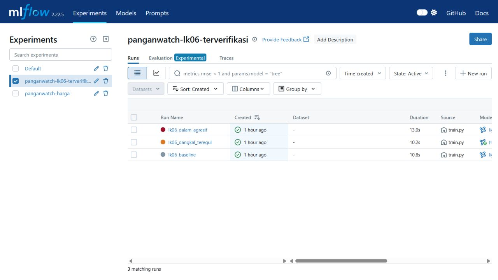
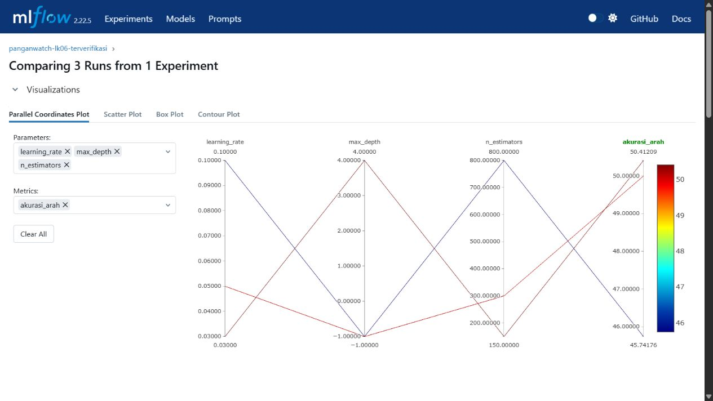
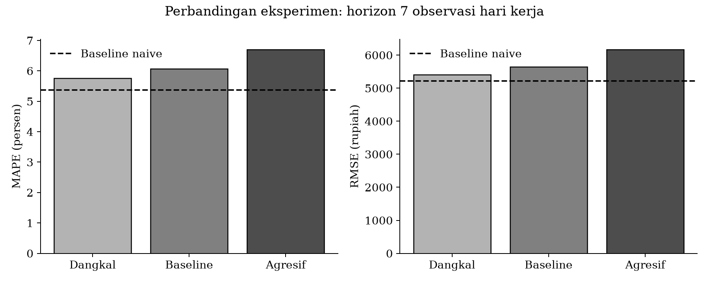
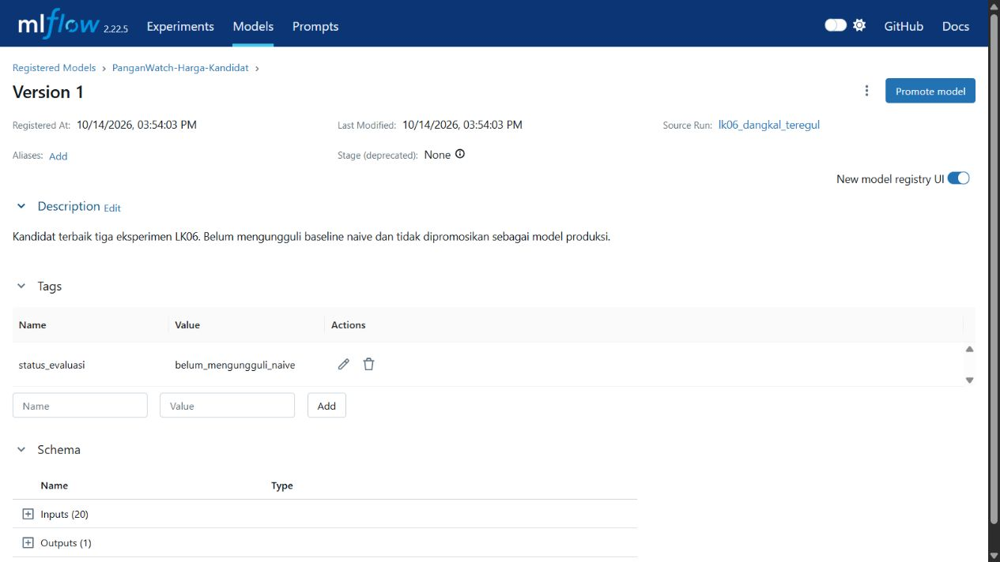

# LK-06 Manajemen Eksperimen Model PanganWatch dengan MLflow

Nama: Ghufron Bagaskara

NIM: 235150200111012

Mata kuliah: Machine Learning Operations (CIF60050)

Proyek: PanganWatch

Tanggal pelaksanaan: 14 Oktober 2026

## 1. Tujuan dan keterkaitan dengan lembar kerja sebelumnya

LK-06 dilaksanakan untuk mengembangkan model regresi dan mencatat variasi eksperimen melalui MLflow. Peneliti menggunakan data harga pangan yang telah diperoleh dan dibersihkan pada LK-04 serta dikelola versinya pada LK-05. Dengan demikian, proses pelatihan melanjutkan alur pengembangan PanganWatch yang telah disusun sejak LK-01, yaitu peramalan harga komoditas pangan pada beberapa kota.

Luaran kegiatan ini berupa skrip `src/train.py`, laporan teknis dengan bukti MLflow UI dan grafik perbandingan metrik, serta dokumentasi parameter model terbaik. Eksperimen dilakukan terhadap data yang tersedia secara lokal. Tidak terdapat penarikan ulang data dari PIHPS maupun Open-Meteo selama kegiatan ini.

## 2. Data dan lingkungan pelaksanaan

Dataset `data/processed/harga_harian.parquet` memuat 13.825 baris untuk 25 deret kota dan komoditas, dengan rentang tanggal 2 September 2024 sampai 14 Oktober 2026. Sebanyak 75 baris merupakan hasil pengisian harga menggunakan nilai sebelumnya. Pengisian tersebut telah ditandai melalui kolom `is_imputed` pada tahap prapemrosesan.

Sumber yang digunakan dalam model ini adalah harga PIHPS. Data cuaca Open-Meteo tetap menjadi bagian rancangan proyek dan tersedia sebagai data mentah, tetapi belum digabungkan sebagai fitur pelatihan. Oleh karena itu, hasil eksperimen ini tidak dapat digunakan untuk menilai pengaruh cuaca terhadap harga pangan.

Eksekusi eksperimen dilaksanakan pada lingkungan Python 3.11 lokal dengan MLflow 2.22.5, LightGBM 4.7.0, pandas 2.3.3, dan NumPy 2.4.6. Konfigurasi Codespaces yang disiapkan pada LK-02 tetap digunakan sebagai dasar reproduksi lingkungan proyek. Bukti pelatihan pada laporan ini berasal dari eksekusi lokal, bukan dari eksekusi baru dalam Codespaces.

## 3. Pembentukan fitur dan pembagian data

Model menggunakan LightGBM Regressor untuk meramalkan perubahan relatif harga. Target dihitung sebagai harga pada observasi ke-h berikutnya dibagi harga pada waktu prediksi, kemudian dikurangi satu. Hasil prediksi perubahan relatif dikembalikan menjadi harga rupiah. Pendekatan tersebut digunakan karena harga beras dan cabai mempunyai skala yang berbeda.

Fitur dibentuk secara terpisah untuk setiap pasangan kota dan komoditas. Fitur tersebut meliputi lag harga, statistik bergerak, momentum, volatilitas, kode kota, kode komoditas, hari dalam pekan, bulan, dan penanda hasil pengisian data. Lag serta statistik bergerak hanya menggunakan observasi terdahulu. Harga target dan tanggal target dikeluarkan dari kolom fitur.

Horizon tujuh pada eksperimen ini berarti tujuh observasi hari kerja. Nilai tersebut tidak sama dengan tujuh hari kalender karena data akhir pekan tidak tersedia. Jendela pengujian ditentukan sepanjang 60 hari kalender pada bagian akhir data yang telah mempunyai label.

Pemisahan latih dan uji juga mempertimbangkan tanggal tersedianya label. Seluruh target data latih harus berada pada atau sebelum 6 Agustus 2026. Waktu awal prediksi pada data uji adalah 7 Agustus 2026, sedangkan target uji terakhir berada pada 14 Oktober 2026. Ketentuan tersebut menghasilkan 11.675 baris latih dan 1.050 baris uji. Sebanyak 175 baris pada batas waktu dikeluarkan dari bagian latih agar targetnya tidak masuk ke periode uji. Pemisahan berdasarkan tanggal awal saja dapat menyebabkan kebocoran label meskipun data tidak diacak.

## 4. Integrasi MLflow dan rancangan eksperimen

Setiap eksekusi `train.py` menghasilkan satu run dengan pencatatan parameter, metrik, dan artefak model. Parameter yang dicatat meliputi horizon, jumlah estimator, laju pembelajaran, kedalaman pohon, jumlah daun, ukuran data, serta batas pembagian waktu. Peneliti juga mencatat hash SHA256 dataset dan kode sumber, commit Git, serta penanda perubahan lokal untuk mengidentifikasi masukan yang digunakan.

Metrik yang dihitung adalah MAE, RMSE, MAPE, akurasi arah, dan skill score terhadap model naive. Prediksi naive menganggap harga pada waktu mendatang sama dengan harga saat ini. Akurasi arah dihitung pada observasi dengan perubahan harga aktual lebih besar dari 0,5 persen. Dengan demikian, metrik tersebut tidak menunjukkan ketepatan pada seluruh hari dan perlu dibaca bersama galat harga.

Tiga konfigurasi LightGBM dijalankan pada dataset, horizon, dan pembagian waktu yang sama. Nilai `random_state` ditetapkan sebesar 42. Artefak yang tersimpan terdiri atas model LightGBM, `feature_importance.csv`, dan `prediksi_uji.csv`. Ketiga run selesai dengan status FINISHED pada eksperimen `panganwatch-lk06-terverifikasi`.

| Konfigurasi | Estimator | Learning rate | Max depth | Num leaves |
| --- | --- | --- | --- | --- |
| Baseline LightGBM | 300 | 0,05 | -1 | 31 |
| Dangkal teratur | 150 | 0,03 | 4 | 15 |
| Dalam agresif | 800 | 0,10 | -1 | 63 |

Nilai `max_depth` sebesar -1 berarti kedalaman tidak dibatasi oleh parameter tersebut.



Gambar 1. Bukti daftar run pada eksperimen yang telah menggunakan pemisahan berdasarkan tanggal label.



Gambar 2. Perbandingan metrik dari tiga konfigurasi pada MLflow UI.

## 5. Hasil dan pemilihan parameter

| Konfigurasi | RMSE (rupiah) | MAPE (persen) | Akurasi arah (persen) |
| --- | --- | --- | --- |
| Baseline LightGBM | 5.645,60 | 6,0647 | 50,0000 |
| Dangkal teratur | 5.403,15 | 5,7548 | 50,4121 |
| Dalam agresif | 6.169,38 | 6,7020 | 45,7418 |
| Naive | 5.214,42 | 5,3746 | Tidak digunakan |

MAE pada konfigurasi baseline, dangkal, dan agresif berturut-turut sebesar Rp3.217,38, Rp3.066,29, dan Rp3.563,21. Skill score terhadap naive pada ketiga konfigurasi tersebut berturut-turut sebesar -0,0827, -0,0362, dan -0,1831.



Gambar 3. Perbandingan galat tiga konfigurasi LightGBM dan garis acuan model naive.

Berdasarkan hasil tersebut, konfigurasi dangkal dipilih sebagai kandidat terbaik di antara tiga model LightGBM. Konfigurasi ini mempunyai MAPE dan RMSE paling rendah serta akurasi arah paling tinggi pada jendela uji yang sama. Peningkatan jumlah estimator dan jumlah daun pada konfigurasi agresif justru diikuti peningkatan galat. Hasil tersebut menunjukkan bahwa kompleksitas tambahan belum memberikan manfaat pada data uji yang digunakan. Penetapan penyebab sebagai overfitting masih memerlukan perbandingan galat latih dan validasi.

Parameter kandidat terbaik adalah `n_estimators=150`, `learning_rate=0.03`, `max_depth=4`, dan `num_leaves=15`. Model tersimpan pada run `7452dabdbaf24ce2ba4f4abbc923db50` dan dapat dimuat melalui URI `runs:/7452dabdbaf24ce2ba4f4abbc923db50/model`. Metadata lengkap disediakan pada `lampiran/best_parameters.json` untuk melanjutkan pengemasan model. Kandidat tersebut telah didaftarkan dalam Model Registry lokal dengan nama `PanganWatch-Harga-Kandidat`, versi 1, dan stage None. URI model terdaftar adalah `models:/PanganWatch-Harga-Kandidat/1`. Registry menggunakan penyimpanan file yang sama dengan tracking eksperimen.



Gambar 4. Registrasi versi pertama model kandidat tanpa promosi ke tahap produksi.

Seluruh konfigurasi LightGBM masih menghasilkan galat lebih besar dibandingkan naive. Skill score yang negatif memperlihatkan kondisi tersebut. Kandidat terbaik belum dinyatakan siap produksi dan belum dipromosikan sebagai model produksi. Pemilihan parameter menggunakan jendela uji yang sama juga bersifat eksploratif. Evaluasi lanjutan memerlukan jendela waktu terpisah sebelum keputusan penerapan dilakukan.

## 6. Verifikasi dan reproduksi

Pengujian dijalankan melalui `py -m pytest tests -q` dengan hasil 20 pengujian berhasil. Lima pengujian pelatihan mencakup pemisahan label, perubahan harga masa depan, isolasi fitur antarkota, perhitungan metrik, dan penolakan horizon atau jendela uji yang tidak valid. Tujuh pengujian memverifikasi prapemrosesan data, sedangkan delapan pengujian memverifikasi proses ingesti. Pemeriksaan kompilasi Python juga berhasil. Ruff 0.17.0 lint dan pemeriksaan format dijalankan setelah pemformatan kode; keduanya lulus.

Kode yang benar-benar digunakan pada tiga run disertakan pada lampiran/train-executed.py. Setelah pemeriksaan format, hash kode kerja berubah, tetapi struktur AST pelatihan tetap identik. Hash eksekusi pada MLflow dipertahankan sebagai identitas kode saat run berlangsung.

Model kandidat terbaik telah dimuat kembali dari artefak MLflow. Sebanyak 1.050 hasil prediksi sesuai dengan berkas `prediksi_uji.csv` pada toleransi relatif 10^-12. Hasil ini memverifikasi bahwa model tersimpan dapat digunakan kembali untuk data uji yang sama.

Eksperimen dapat direplikasi dari direktori proyek menggunakan tiga perintah berikut. Pada Codespaces, perintah `py` diganti dengan `python` sesuai interpreter lingkungan tersebut.

```text
py src/train.py --experiment panganwatch-lk06-terverifikasi --run-name lk06_baseline --n-estimators 300 --learning-rate 0.05 --num-leaves 31
py src/train.py --experiment panganwatch-lk06-terverifikasi --run-name lk06_dangkal_teregul --n-estimators 150 --learning-rate 0.03 --max-depth 4 --num-leaves 15
py src/train.py --experiment panganwatch-lk06-terverifikasi --run-name lk06_dalam_agresif --n-estimators 800 --learning-rate 0.1 --num-leaves 63
```

Pencatatan menggunakan direktori `mlruns` pada proyek. Variabel `MLFLOW_TRACKING_URI` dapat digunakan apabila tracking server yang berbeda diperlukan. Rekap parameter dan metrik aktual tersedia pada `lampiran/eksperimen_terverifikasi.csv` serta `lampiran/eksperimen_terverifikasi.json`. Data yang sama dan batas waktu yang tercatat harus dipertahankan agar hasil perbandingan tetap sebanding.
